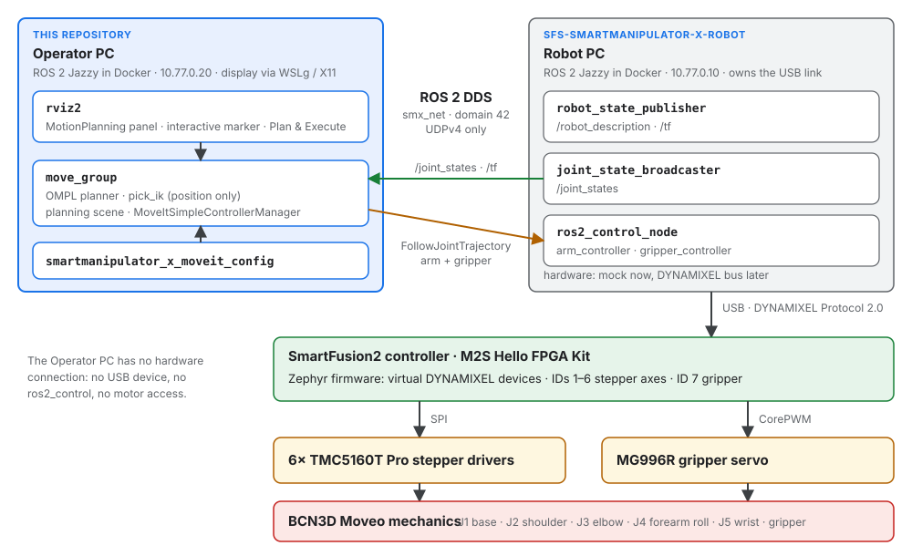

<p align="center">
  
</p>

<h1 align="center">SmartManipulator-X Operator PC</h1>

<p align="center">
  <b>MoveIt 2 motion planning and RViz2 for the SmartManipulator-X arm, connected to the Robot PC over ROS 2 DDS — never to the motor hardware.</b><br>
  ROS 2 Jazzy in Docker · MoveIt 2 (OMPL, pick_ik) · RViz2 on WSLg or X11 · Fast DDS over UDP
</p>

<p align="center">
  <a href="https://github.com/SystemFromScratch/sfs-smartmanipulator-x-operator/actions/workflows/documentation.yml"></a>
  <a href="LICENSE"></a>
</p>

<p align="center">
  <a href="https://systemfromscratch.github.io/sfs-smartmanipulator-x-operator/">Documentation</a> ·
  <a href="https://systemfromscratch.github.io/sfs-smartmanipulator-x-operator/downloads/SmartManipulator-X_Operator_PC_User_Manual.pdf">PDF manual</a> ·
  <a href="https://systemfromscratch.github.io/sfs-smartmanipulator-x-operator/getting-started/">Getting started</a> ·
  <a href="https://systemfromscratch.github.io/sfs-smartmanipulator-x-robot/">System documentation</a>
</p>

---

## Overview

SmartManipulator-X combines the ROS 2 control approach of ROBOTIS OpenMANIPULATOR-X with
the mechanical design of [BCN3D Moveo](https://github.com/BCN3D/BCN3D-Moveo). A
SmartFusion2 controller replaces the DYNAMIXEL actuators: it drives the stepper motors
and the gripper servo and presents them to the ROS 2 host as virtual DYNAMIXEL devices
over Protocol 2.0, over USB CDC — not as a USB-to-DYNAMIXEL bridge.

This repository is the **Operator PC**: MoveIt 2 motion planning and RViz2 for the arm,
ROS 2 Jazzy in Docker, and the documentation of the Operator PC. It never talks to the
motor controllers: it plans in MoveIt and sends the trajectories over ROS 2 DDS to the
Robot PC, which runs `ros2_control` and owns the USB link to the controller.

<p align="center">
  
</p>

| Component | Documentation |
| --- | --- |
| Robot PC: ROS 2 control, robot description | [Robot PC](https://systemfromscratch.github.io/sfs-smartmanipulator-x-robot/robot-pc/) |
| Operator PC: MoveIt 2, RViz2, Gazebo (planned) | this repository · [Operator PC in the system](https://systemfromscratch.github.io/sfs-smartmanipulator-x-robot/operator-pc/) |
| SmartFusion2 controller firmware | [Firmware architecture](https://systemfromscratch.github.io/sfs-smartmanipulator-x-robot/firmware/) |
| Hardware: Hello FPGA Kit, TMC5160 drivers, gripper servo | [Hardware](https://systemfromscratch.github.io/sfs-smartmanipulator-x-robot/hardware/wiring/) |
| The whole system | [System architecture](https://systemfromscratch.github.io/sfs-smartmanipulator-x-robot/architecture/) |

## Project status

- [x] Operator PC image (ROS 2 Jazzy, MoveIt 2, pick_ik, RViz2)
- [x] MoveIt 2 configuration of the Moveo: planning groups, named poses, collision matrix, controller mapping
- [x] Plan & Execute against the Robot PC with mock hardware on a Docker network
- [x] Robot description and DDS profile consumed from the Robot PC repository, not copied
- [ ] Joint limits and accelerations measured on the arm (current values are placeholders)
- [ ] Two-host operation over real Ethernet
- [ ] Gazebo simulation on the Operator PC

## Quick start

Any computer with Docker and Docker Compose v2.17 or later (Windows 11 with the WSL 2
backend shows RViz2 through WSLg; on a Linux desktop see the X11 section of
`docker/env.example`). Clone both repositories side by side — the image build takes the
robot description and the Fast DDS profile from the Robot PC checkout:

```bash
git clone https://github.com/SystemFromScratch/sfs-smartmanipulator-x-robot.git SmartManipulator-X-Robot-PC
git clone https://github.com/SystemFromScratch/sfs-smartmanipulator-x-operator.git SmartManipulator-X-Operator-PC

# terminal 1: the Robot PC (creates the network smx_net)
cd SmartManipulator-X-Robot-PC
docker compose -f docker/docker-compose.yml up --build robot_pc

# terminal 2: the Operator PC (move_group + RViz2)
cd SmartManipulator-X-Operator-PC
docker compose -f docker/docker-compose.yml up --build operator_pc
```

The Robot PC creates the network `smx_net` (`10.77.0.0/24`), which stands in for the
Ethernet link; the Operator PC joins it at `10.77.0.20`. In RViz2, drag the interactive
marker at the gripper (`tool_link`) and click **Plan & Execute** in the MotionPlanning
panel: the Robot PC log shows `arm_controller` accepting the goal, and the arm in RViz2
follows the `/joint_states` that come back. Stop with **Ctrl+C** or
`docker compose -f docker/docker-compose.yml down`.

`docker compose -f docker/docker-compose.yml run --rm shell` opens a shell on `smx_net`
with the same GUI setup, for `ros2 node list`, `ros2 control list_controllers`, `rviz2`
alone or `glxgears`.

In VS Code, **Ctrl+Shift+B** offers *Operator PC: Start (move_group + RViz2)*, *Stop*,
*Rebuild and restart*, *Build image*, *Rebuild image (no cache)* and
*Docs: Build PDF manual*; the shell and the documentation preview are under
**Tasks: Run Task**.

## Two computers

When the Robot PC moves to its own board (Raspberry Pi CM4, Jetson or an Ubuntu 24.04
PC), replace `smx_net` by `network_mode: host` on both sides; `ROS_DOMAIN_ID` (default
`42`) and the Fast DDS profile (UDPv4 only) stay the same. Native Windows ROS 2 cannot
join `smx_net` — Docker Desktop does not route multicast between Windows and its
container networks — so run every ROS 2 node in a container. Details:
[Network and DDS](docs/network.md).

## Project structure

```text
docker/                                   Operator PC image, Compose services, env template
ros2_ws/src/smartmanipulator_x_moveit_config/
                                          SRDF, kinematics (pick_ik), joint limits, controllers,
                                          operator.launch.py, RViz2 layout
tools/docs/                               PDF manual builder, hero illustration and diagrams
docs/, overrides/, mkdocs.yml             documentation (website and PDF manual)
```

Notes on the configuration:

- **Robot model.** Generated from the BCN3D CAD in the Robot PC repository; the
  `cad_pose` group state is the pose of the CAD assembly.
- **5-DOF arm.** The arm cannot reach an arbitrary 6-D pose. pick_ik runs with
  `rotation_scale: 0.0` (position only), so the interactive marker always solves.
- **Collision matrix.** The SRDF disables only adjacent links and the gripper parts
  against each other; the reasoning is in the file.
- **Rendering.** `LIBGL_ALWAYS_SOFTWARE=1` (llvmpipe) is the default because it works on
  every host.

## Documentation

The website and the PDF user manual are built from `docs/` and published by CI to
[GitHub Pages](https://systemfromscratch.github.io/sfs-smartmanipulator-x-operator/).
The documentation of the whole system (Robot PC, firmware, hardware, mechanics) is on the
[SmartManipulator-X system site](https://systemfromscratch.github.io/sfs-smartmanipulator-x-robot/).
Locally, in the repository `.venv` (`pip install -r requirements-docs.txt`; WeasyPrint
needs Pango):

```bash
python -m mkdocs serve                  # live preview
python tools/docs/build_manual.py       # build/manual/SmartManipulator-X_Operator_PC_User_Manual_v<version>.pdf
```

See [Development](docs/development.md) for the details.

## Author

**Anton Vynohradov** — Embedded Systems Engineer · Founder of SystemFromScratch®

[systemfromscratch.com](https://systemfromscratch.com) ·
[GitHub](https://github.com/AntonVynohradov) ·
[LinkedIn](https://www.linkedin.com/in/vynohradov) ·
[ORCID 0009-0005-6965-0911](https://orcid.org/0009-0005-6965-0911) ·
[contact@systemfromscratch.com](mailto:contact@systemfromscratch.com)

## License

Copyright © 2026 Anton Vynohradov. Project-owned files are licensed under the
[Apache License 2.0](LICENSE), matching the ROBOTIS OpenMANIPULATOR-X ROS 2 repository.
Third-party sources keep their own licenses: the ROS 2, MoveIt 2 and pick_ik packages
installed in the image, and the BCN3D Moveo meshes of the robot description taken from
the Robot PC repository (MIT,
`ros2_ws/src/smartmanipulator_x/smartmanipulator_x_description/meshes/LICENSE-BCN3D-Moveo`
there).

SystemFromScratch® is a registered trademark. The Apache License 2.0 grants no rights to
use the SystemFromScratch® name or logo; they may not be used to endorse or promote
products derived from SmartManipulator-X without prior written permission. ROS is a
trademark of Open Source Robotics Foundation, Inc.; MoveIt is a trademark of PickNik Inc.;
ROBOTIS, DYNAMIXEL and OpenMANIPULATOR are trademarks of ROBOTIS Co., Ltd.; SmartFusion2
is a trademark of Microchip Technology Inc.; SmartManipulator-X is not affiliated with or
endorsed by them.
