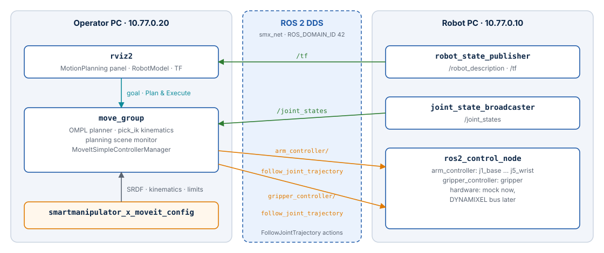
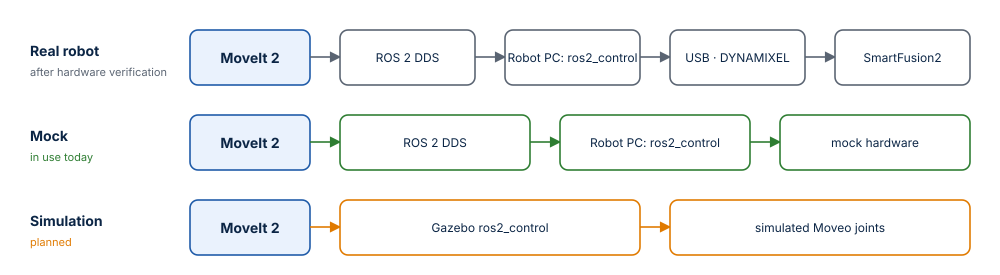

# Architecture

The Operator PC is one of the two ROS 2 computers of SmartManipulator-X. This page shows
how its nodes connect to the Robot PC, what crosses the network, and which rules keep the
two sides consistent. The architecture of the whole system (controller firmware, FPGA,
hardware) is on the
[system site](https://systemfromscratch.github.io/sfs-smartmanipulator-x-robot/architecture/).

## ROS 2 graph



| Node | Computer | Started by | Role |
| --- | --- | --- | --- |
| `move_group` | Operator PC | `operator.launch.py` | Planning (OMPL), IK (pick_ik), planning scene, trajectory execution |
| `rviz2` | Operator PC | `operator.launch.py` (`rviz:=true`) | MotionPlanning plugin, operator interface |
| `robot_state_publisher` | Robot PC | `robot.launch.py` | `/robot_description`, `/tf` from `/joint_states` |
| `ros2_control_node` | Robot PC | `robot.launch.py` | Controller manager at 100 Hz, hardware interface (mock now) |
| `joint_state_broadcaster` | Robot PC | spawner | `/joint_states` from the hardware state interfaces |
| `arm_controller`, `gripper_controller` | Robot PC | spawner | `joint_trajectory_controller`, position command interface |

## What crosses the network

| Interface | Type | Direction | Used for |
| --- | --- | --- | --- |
| `/joint_states` | topic `sensor_msgs/JointState` | Robot PC → Operator PC | Current state of the arm for `move_group` and RViz2 |
| `/tf`, `/tf_static` | topics | Robot PC → Operator PC | Frames of the robot (RViz2 TF and RobotModel displays) |
| `/robot_description` | topic, transient local | both | Published by `robot_state_publisher` and, with the same model, by `move_group` (`publish_robot_description`); read by the RobotModel display (off by default) |
| `/arm_controller/follow_joint_trajectory` | action `control_msgs/FollowJointTrajectory` | Operator PC → Robot PC | Arm trajectories (J1–J5) |
| `/gripper_controller/follow_joint_trajectory` | action `control_msgs/FollowJointTrajectory` | Operator PC → Robot PC | Gripper trajectories |
| `/display_planned_path`, `/monitored_planning_scene`, MoveIt actions and services | | inside the Operator PC | RViz2 ↔ `move_group` |

Nothing else is needed from the Robot PC: no controller-manager services, no USB device,
no file system.

## The robot model on both sides

`move_group` and RViz2 do not read `/robot_description` from the Robot PC to plan. The
launch file expands the **same Xacro file** the Robot PC uses —
`smartmanipulator_x_description/urdf/smartmanipulator_x.urdf.xacro` — which the image build
copied from the Robot PC repository (see [build contexts](docker.md#build-contexts)):

```python
MoveItConfigsBuilder("smartmanipulator_x", package_name="smartmanipulator_x_moveit_config")
    # Same model as the Robot PC; the hardware block is irrelevant to MoveIt.
    .robot_description(file_path=description_xacro, mappings={"use_mock_hardware": "true"})
```

The `use_mock_hardware` mapping only selects the `ros2_control` block of the Xacro, which
MoveIt ignores. Links, joints, limits and meshes are identical to the Robot PC's — as long
as both images were built from the same Robot PC commit. After a change to the robot
description, rebuild **both** images.

## Responsibilities and boundaries

| Rule | Why |
| --- | --- |
| The Operator PC never opens the controller's USB device; do not pass `/dev/ttyACM0` to it | Only the Robot PC owns the hardware path and its safety |
| No URDF/Xacro in this repository; consume `smartmanipulator_x_description` | One canonical model, generated from the Moveo CAD |
| No OpenMANIPULATOR-X model or configuration as a stand-in for the Moveo | Different geometry, joints and actuators |
| Controller names and joints in `moveit_controllers.yaml` match `controllers.yaml` of the Robot PC | Otherwise MoveIt cannot find the action servers or the joints do not match |
| MoveIt 2, RViz2 and (later) Gazebo stay out of the Robot PC image | The Robot PC stays lean and headless |
| ROS 2 data goes over DDS, never over SSH | SSH is for administration only |

## Real robot and simulation

The same MoveIt configuration is meant to drive either path; the robot model, joint
names, limits, planning groups and controller semantics must agree in both:



Today the Operator PC drives the **mock** path. The real path becomes available when the
Robot PC enables its verified DYNAMIXEL hardware configuration; nothing changes on the
Operator PC for that. Gazebo integration will live in this repository.

## Package layout

```text
ros2_ws/src/smartmanipulator_x_moveit_config/
├── package.xml                     ament_cmake; exec-depends on MoveIt, pick_ik, RViz2, the description
├── CMakeLists.txt                  installs config/, launch/, rviz/
├── config/
│   ├── smartmanipulator_x.srdf     planning groups, named states, end effector, collision matrix
│   ├── kinematics.yaml             pick_ik, position-only
│   ├── joint_limits.yaml           accelerations and default scaling
│   └── moveit_controllers.yaml     arm_controller, gripper_controller, execution tolerances
├── launch/operator.launch.py       move_group + RViz2
└── rviz/moveit.rviz                RViz2 layout
```

Each file is described in [MoveIt 2 configuration](moveit-config.md).
