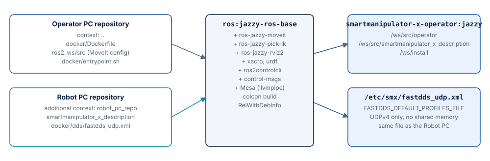

# Docker image and Compose

The Operator PC runs entirely in Docker: one image, two Compose services, and the GUI
shown on the host through WSLg (Windows 11) or X11 (Linux). ROS 2 is not installed on the
host.

| File | Content |
| --- | --- |
| `docker/Dockerfile` | `ros:jazzy-ros-base` with MoveIt 2, pick_ik, RViz2; builds the workspace |
| `docker/docker-compose.yml` | `operator_pc` (move_group + RViz2) and `shell` (profile `tools`) on the network `smx_net` |
| `docker/entrypoint.sh` | Sources ROS 2 and the built workspace, then runs the command |
| `docker/env.example` | Template for `docker/.env` |
| `.dockerignore` | Keeps build output, editor files and the documentation out of the build context (the repository root) |

## The image



| Step | Content |
| --- | --- |
| Base | `ros:jazzy-ros-base` (Ubuntu 24.04, ROS 2 Jazzy) |
| Packages | `ros-jazzy-moveit`, `ros-jazzy-pick-ik`, `ros-jazzy-rviz2`, `ros-jazzy-xacro`, `ros-jazzy-urdf`, `ros-jazzy-ros2controlcli`, `ros-jazzy-control-msgs`, `python3-colcon-common-extensions`, Mesa (`libgl1-mesa-dri`, `mesa-utils`) |
| Robot description | `smartmanipulator_x_description` from the Robot PC repository → `/ws/src/smartmanipulator_x_description` |
| DDS profile | `docker/dds/fastdds_udp.xml` from the Robot PC repository → `/etc/smx/fastdds_udp.xml` |
| Project packages | `ros2_ws/src` of this repository → `/ws/src/operator` |
| Build | `colcon build --symlink-install`, `RelWithDebInfo` |
| Shell | `.bashrc` sources `/opt/ros/jazzy` and `/ws/install`, so `docker exec … bash` has ROS 2 ready |

Environment of the image:

| Variable | Value |
| --- | --- |
| `ROS_DISTRO` | `jazzy` |
| `ROS_WS` | `/ws` |
| `RMW_IMPLEMENTATION` | `rmw_fastrtps_cpp` |
| `ROS_DOMAIN_ID` | `42` (Compose overrides it from `docker/.env`) |
| `FASTDDS_DEFAULT_PROFILES_FILE`, `FASTRTPS_DEFAULT_PROFILES_FILE` | `/etc/smx/fastdds_udp.xml` |
| `TZ` | `Europe/Warsaw` |

The image tag is `smartmanipulator-x-operator:jazzy` (`SMX_OPERATOR_IMAGE`).

## Build contexts

The robot description and the DDS profile are **not** copied into this repository. The
Dockerfile reads them from a second build context, `robot_pc_repo`, which Compose points
at the Robot PC checkout:

```yaml
build:
  context: ..
  dockerfile: docker/Dockerfile
  additional_contexts:
    # Canonical robot description and DDS profile.
    robot_pc_repo: ${SMX_ROBOT_PC_REPO:-../../SmartManipulator-X-Robot-PC}
```

```dockerfile
COPY --from=robot_pc_repo ros2_ws/src/smartmanipulator_x/smartmanipulator_x_description \
     ${ROS_WS}/src/smartmanipulator_x_description
COPY --from=robot_pc_repo docker/dds/fastdds_udp.xml /etc/smx/fastdds_udp.xml
```

So both computers always use the same joints and transport settings. The relative path
is resolved from `docker/`; the default expects both repositories side by side. This
needs Docker Compose v2.17 or later and BuildKit.

To build without Compose:

```bash
docker build -f docker/Dockerfile \
    --build-context robot_pc_repo=../SmartManipulator-X-Robot-PC \
    -t smartmanipulator-x-operator:jazzy .
```

## Services

| Service | Profile | Network | Command | Use |
| --- | --- | --- | --- | --- |
| `operator_pc` | default | `smx_net`, fixed 10.77.0.20 (`SMX_OPERATOR_IP`) | `ros2 launch smartmanipulator_x_moveit_config operator.launch.py` | `move_group` + RViz2 |
| `shell` | `tools` | `smx_net`, dynamic address | `bash` (interactive) | ROS 2 CLI, `rviz2` alone, `glxgears` |

Both use `init: true` (a small init process reaps child processes) and the same ROS and
GUI environment. `operator_pc` stops with `SIGINT`, like Ctrl+C in a terminal, so
`ros2 launch` shuts its nodes down cleanly.

```bash
docker compose -f docker/docker-compose.yml up --build operator_pc     # start
docker compose -f docker/docker-compose.yml run --rm shell             # shell
docker compose -f docker/docker-compose.yml build operator_pc          # rebuild only
docker compose -f docker/docker-compose.yml build --no-cache --pull operator_pc   # from scratch
docker compose -f docker/docker-compose.yml down                       # remove containers
```

`smx_net` is declared `external`: it belongs to the Robot PC Compose project, which
creates it. `down` here leaves it in place.

## Environment

Every value has a default in `docker-compose.yml`. Copy `docker/env.example` to
`docker/.env` only to change one; `docker/.env` is ignored by Git.

| Variable | Default | Meaning |
| --- | --- | --- |
| `ROS_DOMAIN_ID` | `42` | Must match the Robot PC |
| `SMX_OPERATOR_IP` | `10.77.0.20` | Address of `operator_pc` on `smx_net` (the Robot PC is 10.77.0.10) |
| `SMX_ROBOT_PC_REPO` | `../../SmartManipulator-X-Robot-PC` | Robot PC checkout, relative to `docker/` or absolute |
| `SMX_OPERATOR_IMAGE` | `smartmanipulator-x-operator:jazzy` | Image name and tag |
| `SMX_X11_DIR` | `/run/desktop/mnt/host/wslg/.X11-unix` | Host directory mounted as `/tmp/.X11-unix` |
| `SMX_WSLG_DIR` | `/run/desktop/mnt/host/wslg` | Host directory mounted as `/mnt/wslg` |
| `SMX_DISPLAY` | `:0` | `DISPLAY` |
| `SMX_WAYLAND_DISPLAY` | `wayland-0` | `WAYLAND_DISPLAY` |
| `SMX_XDG_RUNTIME_DIR` | `/mnt/wslg/runtime-dir` | `XDG_RUNTIME_DIR` |
| `SMX_PULSE_SERVER` | `/mnt/wslg/PulseServer` | `PULSE_SERVER` (WSLg audio; unused by RViz2) |
| `SMX_LIBGL_ALWAYS_SOFTWARE` | `1` | `1`: software OpenGL (llvmpipe) |

Fixed in the Compose file: `RMW_IMPLEMENTATION=rmw_fastrtps_cpp`,
`ROS_AUTOMATIC_DISCOVERY_RANGE=SUBNET`, `QT_QPA_PLATFORM=xcb`, `QT_X11_NO_MITSHM=1`.

## GUI on Windows 11 (WSLg)

The defaults are made for Docker Desktop with the WSL 2 backend. Docker Desktop exposes
the WSLg sockets of its VM under `/run/desktop/mnt/host/wslg`; Compose mounts them into
the container, and RViz2 draws through X11 (`QT_QPA_PLATFORM=xcb`) on the WSLg display
`:0`. Nothing has to be configured; run the Compose commands from PowerShell or from a
WSL distribution.

## GUI on a Linux desktop (X11)

Allow local containers to connect to your X server once per session, and set the X11
values in `docker/.env`:

```bash
xhost +local:docker
cp docker/env.example docker/.env
```

```ini
# docker/.env
SMX_X11_DIR=/tmp/.X11-unix
SMX_WSLG_DIR=/tmp/smx-no-wslg
SMX_DISPLAY=:0
SMX_XDG_RUNTIME_DIR=/tmp
```

`SMX_DISPLAY` must match `echo $DISPLAY` on the host. `SMX_WSLG_DIR` only needs to be a
path that exists or can be created; nothing is used from it on Linux.

## Rendering

`LIBGL_ALWAYS_SOFTWARE=1` (Mesa llvmpipe) is the default because it works on every host,
without GPU drivers in the container. RViz2 with the Moveo model is usable this way;
it costs CPU. With a working GPU path (for example `/dev/dri` passed through on Linux with a
Compose override, or the WSLg D3D12 driver), set `SMX_LIBGL_ALWAYS_SOFTWARE=0`. Check with `glxinfo -B` or
`glxgears` in the `shell` service which renderer is in use.
