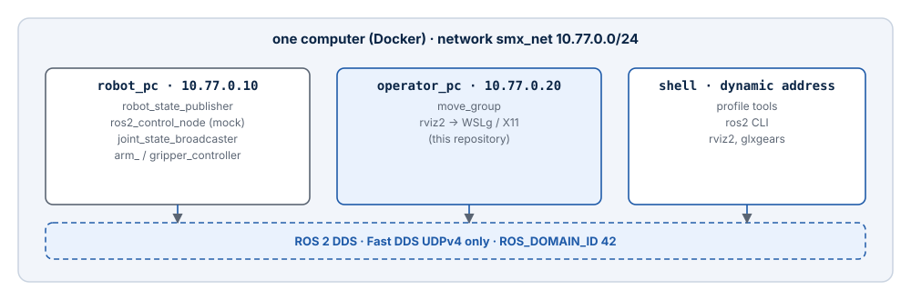

# Network and DDS

The Operator PC and the Robot PC talk only through ROS 2 DDS, like two computers on an
Ethernet. On one computer, the Docker network `smx_net` stands in for that cable; on two
computers, the real network does. The domain ID and the DDS profile stay the same in
both cases.

## One computer: smx_net



| Setting | Robot PC | Operator PC |
| --- | --- | --- |
| Network | creates `smx_net` (10.77.0.0/24, `SMX_SUBNET`) | joins it as `external` |
| Address | 10.77.0.10 (`SMX_ROBOT_IP`) | 10.77.0.20 (`SMX_OPERATOR_IP`) |
| `ROS_DOMAIN_ID` | 42 | 42 |
| `RMW_IMPLEMENTATION` | `rmw_fastrtps_cpp` | `rmw_fastrtps_cpp` |
| Fast DDS profile | `docker/dds/fastdds_udp.xml` | the same file, copied at build time to `/etc/smx/fastdds_udp.xml` |
| `ROS_AUTOMATIC_DISCOVERY_RANGE` | | `SUBNET` |

## The Fast DDS profile: UDP only

Fast DDS uses shared memory between participants it believes are on the same host.
Containers on one computer have separate `/dev/shm`, so discovery can succeed while no
data arrives — the nodes are listed, but topics stay silent. The profile disables the
built-in transports and keeps all traffic on UDPv4:

```xml
<participant profile_name="smx_udp_only" is_default_profile="true">
  <rtps>
    <userTransports>
      <transport_id>smx_udpv4</transport_id>
    </userTransports>
    <useBuiltinTransports>false</useBuiltinTransports>
  </rtps>
</participant>
```

UDP is also what the real Ethernet link carries, so simulation and hardware use the same
transport. The file belongs to the Robot PC repository; the image build copies it, so a
change there reaches the Operator PC with the next `--build`.

## Two computers: real Ethernet

When the Robot PC moves to its own board (Raspberry Pi CM4, Jetson or an Ubuntu 24.04
PC), replace `smx_net` by the host network on **both** sides:

1. In both Compose files, remove the `networks` entries of the services and the
   `smx_net` declaration, and add `network_mode: host`.
2. Keep `ROS_DOMAIN_ID`, `RMW_IMPLEMENTATION` and the Fast DDS profile unchanged.
3. Make sure both computers are in one subnet and the firewall lets DDS through (UDP,
   ports 7400 and up for domain 42 — the RTPS ports are computed from the domain ID; the
   simplest rule allows UDP between the two hosts).
4. Check discovery from both sides with `ros2 node list`, then
   `ros2 topic echo /joint_states --once` on the Operator PC.

`network_mode: host` gives a container the network of the Docker host. On Linux that is
the real network. With Docker Desktop on Windows the Docker host is a VM, so a host-mode
container is not necessarily reachable from the Robot PC; verify discovery in both
directions, or run the Operator PC on a Linux computer for two-host operation.

## Native Windows ROS 2 cannot join

ROS 2 installed natively on Windows does not discover the containers on `smx_net`:
Docker Desktop does not route multicast between Windows and its container networks. Run
every ROS 2 node of the system in a container on that network — for the command line, use
the `shell` service.

## SSH is not a ROS transport

SSH is for administration (logs, updates, starting containers on the Robot PC). ROS 2
topics and actions always go over DDS; do not tunnel or forward them through SSH.

## Checklist

| Check | Command (in the `shell` service) | Expected |
| --- | --- | --- |
| Same domain | `echo $ROS_DOMAIN_ID` | `42` on both sides |
| Discovery | `ros2 node list` | `/move_group`, `/rviz2`, `/robot_state_publisher`, `/controller_manager`, … |
| Joint states | `ros2 topic echo /joint_states --once` | Six joint names with positions |
| Controllers | `ros2 control list_controllers` | `arm_controller`, `gripper_controller`, `joint_state_broadcaster` active |
| Actions | `ros2 action list` | `/arm_controller/follow_joint_trajectory`, `/gripper_controller/follow_joint_trajectory` |
| Profile | `echo $FASTDDS_DEFAULT_PROFILES_FILE` | `/etc/smx/fastdds_udp.xml` |
