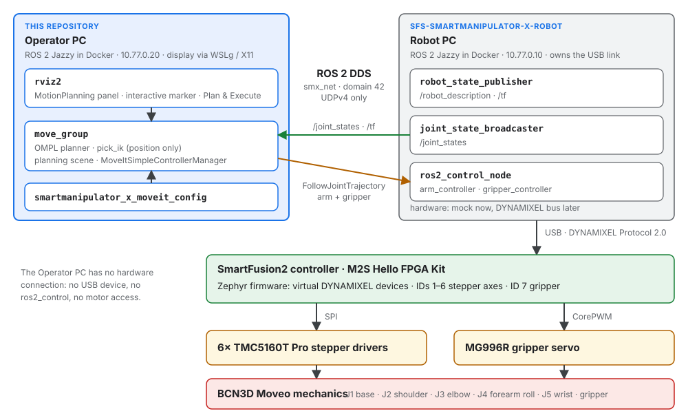

# Overview

SmartManipulator-X is a robot arm project. It combines the ROS 2 control and
operator-software concepts of ROBOTIS
[OpenMANIPULATOR-X](https://emanual.robotis.com/docs/en/platform/openmanipulator_x/overview/)
with the mechanical design of [BCN3D Moveo](https://github.com/BCN3D/BCN3D-Moveo). A
Microchip SmartFusion2 controller drives the stepper motors of the Moveo joints and a
hobby servo on the gripper, and presents them to the ROS 2 host as virtual DYNAMIXEL
devices over Protocol 2.0.

This documentation covers the **Operator PC**: the computer on which the operator plans
motions and watches the arm. The whole system — the Robot PC, the controller firmware,
the hardware and the mechanics — is documented on the
[SmartManipulator-X system site](https://systemfromscratch.github.io/sfs-smartmanipulator-x-robot/),
which is published from the Robot PC repository.

## What the Operator PC does

| Owns | Does not own |
| --- | --- |
| MoveIt 2 motion planning (`move_group`, OMPL, pick_ik) | The USB link to the SmartFusion2 controller (`/dev/ttyACM0`) |
| RViz2 with the MotionPlanning panel | `ros2_control`, the controllers and the hardware interface |
| The semantic robot description (SRDF), kinematics, planning limits, controller mapping | The robot description (URDF/Xacro and meshes) — it is consumed from the Robot PC repository |
| Its Docker image, Compose services and GUI setup | The motor drivers, the firmware, the power and the emergency stop |
| Simulation workflows (Gazebo: planned, not in this repository yet) | |

The Operator PC never talks to the motor controllers. It plans in MoveIt and sends the
trajectories as `FollowJointTrajectory` actions over ROS 2 DDS to the Robot PC, which
runs `ros2_control`:

## System components

| Component | Role | Platform |
| --- | --- | --- |
| **Operator PC** (this repository) | Motion planning and visualization: MoveIt 2, RViz2; simulation later | ROS 2 Jazzy in Docker; DDS client of the Robot PC |
| Robot PC | Robot-side ROS 2 control: `ros2_control`, the ROBOTIS hardware interface and DynamixelSDK; owns the USB link to the controller | Ubuntu 24.04, ROS 2 Jazzy in Docker |
| Controller firmware | DYNAMIXEL Protocol 2.0 device: six stepper axes (IDs 1–6), the gripper servo (ID 7) and a controller device (ID 200) | Zephyr RTOS on the SmartFusion2 Cortex-M3 |
| FPGA design | Pin routing of SPI and UART, CorePWM for the gripper servo | SmartFusion2 FPGA fabric |
| Drives | Six TMC5160 modules in motion-controller mode, MG996R gripper servo | 24 V and 6 V supplies |
| Mechanics | Joints, links and printed parts | BCN3D Moveo |

## Repositories

| Repository | Content | Documentation |
| --- | --- | --- |
| sfs-smartmanipulator-x-operator | **This repository**: Operator PC image, MoveIt 2 configuration, RViz2 setup, this documentation | This site; the system view in [Operator PC](https://systemfromscratch.github.io/sfs-smartmanipulator-x-robot/operator-pc/) |
| sfs-smartmanipulator-x-robot | Robot PC image and ROS 2 workspace, the robot description generated from the Moveo CAD, the Fast DDS profile, the system documentation | [Robot PC](https://systemfromscratch.github.io/sfs-smartmanipulator-x-robot/robot-pc/), [BCN3D Moveo mechanics](https://systemfromscratch.github.io/sfs-smartmanipulator-x-robot/mechanical/) |
| SmartManipulator-X-Controller | Zephyr firmware of the SmartFusion2 and the motor tester GUI | [Firmware](https://systemfromscratch.github.io/sfs-smartmanipulator-x-robot/firmware/), [Motor tester GUI](https://systemfromscratch.github.io/sfs-smartmanipulator-x-robot/gui/) |
| SmartManipulator-X-Libero | FPGA design of the SmartFusion2 | [Hardware](https://systemfromscratch.github.io/sfs-smartmanipulator-x-robot/hardware/wiring/) |

The two computer repositories are checked out **side by side**. The Operator PC image
build reads the robot description and the DDS profile from the Robot PC checkout
(default path `../SmartManipulator-X-Robot-PC`), see
[Docker image and Compose](docker.md#build-contexts).

## Joint contract

The Operator PC, the Robot PC and the real hardware use the same joint names. They are
defined in `smartmanipulator_x_description` in the Robot PC repository; the Operator PC
only refers to them.

| Joint | Moveo axis | DYNAMIXEL ID (SmartFusion2) | MoveIt group | Controller |
| --- | --- | --- | --- | --- |
| `j1_base` | J1 base | 1 | `arm` | `arm_controller` |
| `j2_shoulder` | J2 shoulder | 2 and 3 (two mirrored motors) | `arm` | `arm_controller` |
| `j3_elbow` | J3 elbow | 4 | `arm` | `arm_controller` |
| `j4_forearm_roll` | J4 forearm roll | 5 | `arm` | `arm_controller` |
| `j5_wrist` | J5 wrist | 6 | `arm` | `arm_controller` |
| `gripper` | gripper servo | 7 | `gripper` | `gripper_controller` |

The gripper linkage has mimic joints (`gripper_idler_gear`, `gripper_pivot_*`,
`gripper_finger_*`) that follow `gripper`; they are neither planned nor commanded.

## Current status

- **Operator PC (this repository):** ROS 2 Jazzy image with MoveIt 2, pick_ik and RViz2;
  `move_group` and RViz2 start with one Compose command, join `smx_net`, plan with OMPL
  and execute through the Robot PC's `arm_controller` and `gripper_controller`, with the
  Robot PC running mock hardware on the same computer.
- **Robot model:** generated from the BCN3D Moveo CAD in the Robot PC repository. Joint
  limits are still placeholders until measured on the real arm; the MoveIt joint limits
  of this repository are conservative placeholders as well.
- **Real hardware:** not reachable from the Operator PC yet — the Robot PC refuses
  `use_mock_hardware:=false` until its real-hardware `ros2_control` path is verified
  (see the [Robot PC documentation](https://systemfromscratch.github.io/sfs-smartmanipulator-x-robot/robot-pc/)).
- **Open items:** Gazebo simulation on the Operator PC, measured joint limits and
  velocities, two-host operation over real Ethernet, orientation goals with a
  5-DOF-aware IK setting.
