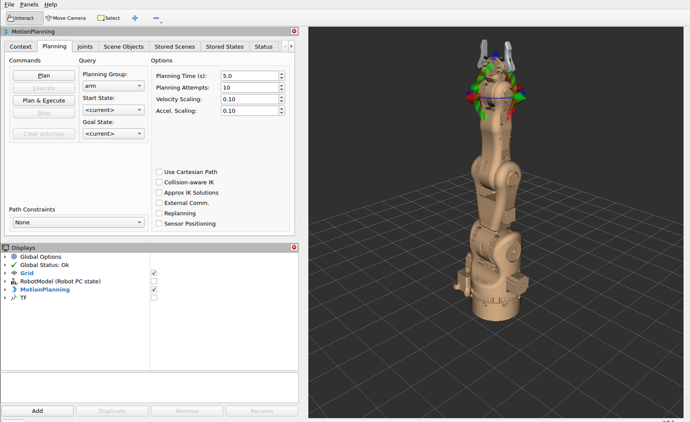
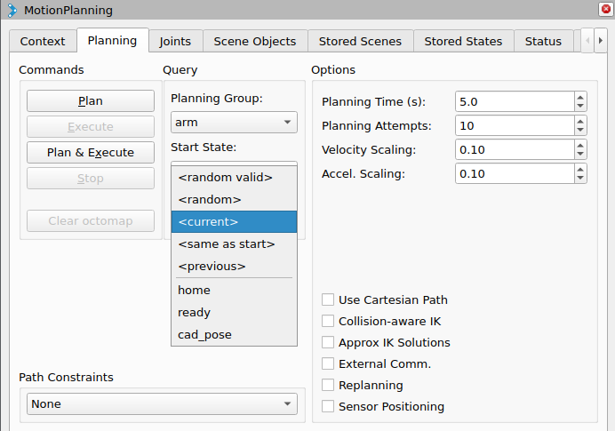
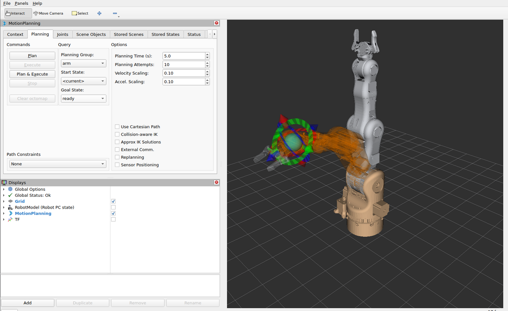
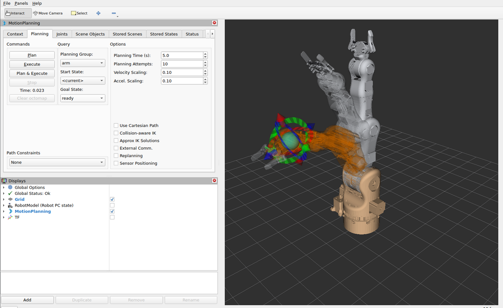
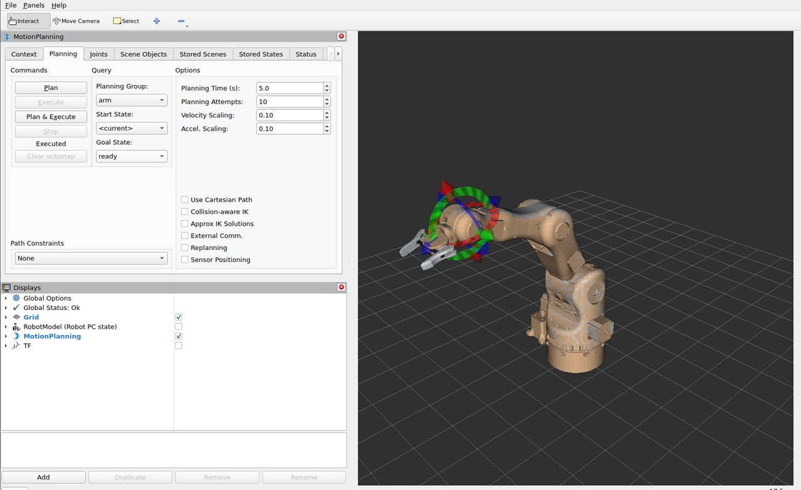
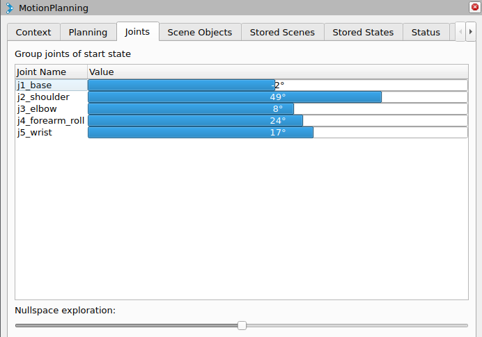
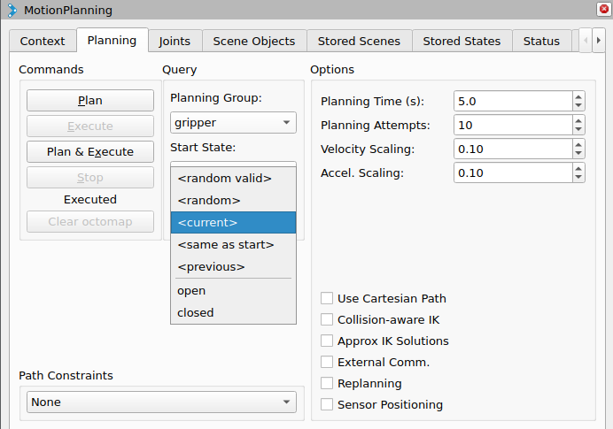
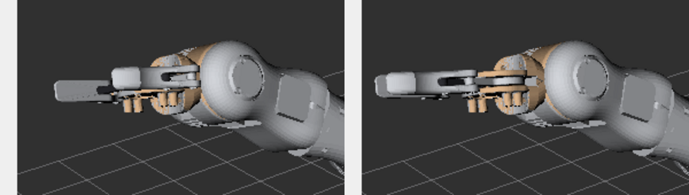
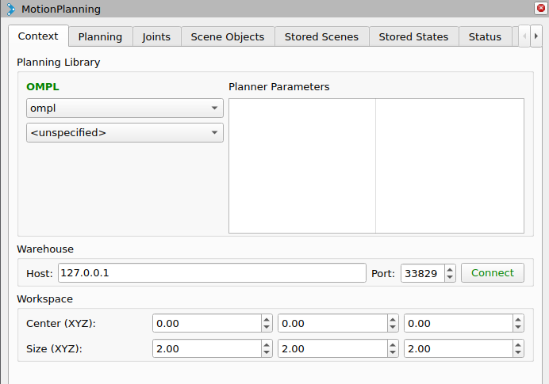

# Planning in RViz2

RViz2 is the operator interface of the Operator PC. It starts with
`rviz/moveit.rviz` from `smartmanipulator_x_moveit_config` and talks to `move_group`
through the MoveIt **MotionPlanning** plugin. Every plan is computed on the Operator PC;
only the execution goes to the Robot PC.

This page walks through a complete session: start, a named goal, planning, execution,
a goal set with the interactive marker, the joint view, the gripper and the planner
settings. The screenshots were taken with the Robot PC running mock hardware on
`smx_net`; with mock hardware every commanded position becomes the joint state at once,
so the arm in RViz2 follows the trajectory exactly.

## Before you start

| Check | How |
| --- | --- |
| The Robot PC runs | In the Robot PC repository: `docker compose -f docker/docker-compose.yml up robot_pc` |
| The Operator PC runs | In this repository: `docker compose -f docker/docker-compose.yml up operator_pc` ([Getting started](getting-started.md)) |
| `move_group` is ready | Its log ends with `You can start planning now!` |

Two `ERROR` lines in the log at start-up are normal and can be ignored:

| Message | Meaning |
| --- | --- |
| `No 3D sensor plugin(s) defined for octomap updates` | No depth camera is configured; the planning scene has no octomap |
| `Action server: /recognize_objects not available` | The *Detect* button of the Scene Objects tab has no object recognition behind it |

## 1. The window



| Area | Content |
| --- | --- |
| Toolbar | **Interact** (move the marker, the default tool), **Move Camera**, **Select** |
| MotionPlanning panel | Tabs *Context*, *Planning*, *Joints*, *Scene Objects*, *Stored Scenes*, *Stored States*, *Status*, *Manipulation* (behind the arrow) |
| Displays | Grid, RobotModel (Robot PC state), MotionPlanning, TF — tick a box to show a display |
| 3D view | The arm, the goal and the planned path in the fixed frame `world` |

What the 3D view shows:

| You see | It is |
| --- | --- |
| Arm in its own colours (light grey, metal parts) | The **current state**, as reported by the Robot PC in `/joint_states` |
| Orange, semi-transparent arm | The **goal state** (35 % opacity). Where it overlaps the current state the arm looks tan, as right after start |
| Red, green and blue arrows and rings at the gripper | The **interactive marker** on `tool_link`, the tip of the `arm` chain |
| Grey arm moving from start to goal | The **planned path** preview after *Plan* |

| Display | Default | Shows |
| --- | --- | --- |
| Grid | on | 10 cm cells, 2 m × 2 m, in the fixed frame `world` |
| MotionPlanning | on | Current state, goal state, interactive marker, planned path |
| RobotModel (Robot PC state) | off | The model from `/robot_description`, posed by the Robot PC's `/tf` |
| TF | off | All frames of the robot |

Camera: left mouse button drag rotates the view around the focal point, middle button
(or Shift + left) pans, the wheel zooms. With the **Interact** tool, a drag that starts
**on** the marker moves the marker; a drag that starts anywhere else rotates the camera.

## 2. Choose a named goal

In the **Planning** tab, check *Planning Group* `arm` and *Start State* `<current>`,
then open **Goal State**. The list has the special entries and the named poses from the
SRDF:



| Entry | Goal |
| --- | --- |
| `<random valid>` | A random collision-free state — useful to exercise the planner |
| `<random>` | A random state, may be in collision |
| `<current>` | The present state of the arm (no motion) |
| `<same as start>` | The start state |
| `<previous>` | The goal before the last change |
| `home` | All arm joints at 0 |
| `ready` | j2 0.5, j3 0.8, j5 0.6 rad, others 0 |
| `cad_pose` | j2 0.7416, j3 0.4674, j4 0.1426, j5 0.9151 rad — the pose of the BCN3D CAD assembly |

Choose **ready**. The orange goal arm moves to the pose, the current arm stays where it
is, and the marker jumps to the goal's `tool_link`:



## 3. Plan and check the preview

Click **Plan**. `move_group` plans with OMPL; the time appears under the buttons (here
*Time: 0.023* s) and **Execute** becomes active. The grey arm plays the trajectory from
the current state to the goal, so you can check the path before anything moves:



If the result is not what you want, change the goal and click **Plan** again; nothing
has been sent to the Robot PC yet.

## 4. Execute

Click **Execute**. The trajectory goes as a `FollowJointTrajectory` goal to the Robot PC;
the status under the buttons changes to *Executed* when the controller reports success,
and the current arm stands in the goal pose:



The two logs show the same execution from both sides:

```text
Operator PC (move_group)
  sending trajectory to arm_controller
  arm_controller started execution
  Goal request accepted!
  Controller 'arm_controller' successfully finished
  Completed trajectory execution with status SUCCEEDED ...

Robot PC (ros2_control_node)
  [arm_controller]: Received new action goal
  [arm_controller]: Accepted new action goal
  [arm_controller]: Goal reached, success!
```

**Plan & Execute** does steps 3 and 4 in one click, without the chance to check the
preview. **Stop** cancels a running execution.

## 5. Set a goal with the interactive marker

The marker sits on `tool_link` of the goal state. With the **Interact** tool:

| Handle | Moves the goal |
| --- | --- |
| Arrow (red, green, blue) | Along that axis of the marker |
| Ring | Rotation about that axis |
| Sphere in the centre | Freely in the view plane |

Grab a handle and drag. While pick_ik finds a solution, the orange goal arm follows the
marker:


Then **Plan** (and check the preview) and **Execute**, or **Plan & Execute**.

!!! info "Position goals only"
    The Moveo has five arm joints, so it cannot reach an arbitrary position *and*
    orientation. The IK solver matches the tool **position** and ignores its
    orientation (`rotation_scale: 0.0` in `config/kinematics.yaml`), so the marker
    always solves for reachable positions; turning the rings has little or no effect
    on the goal. See [MoveIt 2 configuration](moveit-config.md#kinematics) for a
    best-effort orientation.

If the marker is dragged out of reach, the goal arm stops following (no IK solution);
drag it back towards the base.

## 6. Joints tab

The **Joints** tab lists the joints of the planning group with their values in degrees.
Drag a bar to change one joint directly — useful for small corrections, for example of
`j4_forearm_roll`, which the position-only marker does not set:



The tab header names the state the bars belong to. *Nullspace exploration* moves the arm
inside the set of joint values that keep the tool where it is.

## 7. The gripper

In the **Planning** tab, set *Planning Group* to `gripper`. The marker disappears: the
gripper is a single joint, not a chain. *Goal State* lists `open` (gripper 0.0 rad) and
`closed` (gripper 1.4 rad; limit 1.45):



Choose **closed** and click **Plan & Execute**. MoveIt sends a one-joint trajectory to
`gripper_controller` on the Robot PC; the gears, pivot arms and fingers mimic the
`gripper` joint and move with it:



Switch back to *Planning Group* `arm` for arm motions.

## 8. Speed of the motion

The **Velocity Scaling** and **Accel. Scaling** fields in the Planning tab scale the
joint limits for each request (0–1). RViz2 starts with **0.10**: the arm moves at 10 % of
the limits of the robot description (1.0 rad/s for every joint) and of
`config/joint_limits.yaml` (1.0 rad/s²).

| Motion (measured with mock hardware, scaling 0.10) | Duration |
| --- | --- |
| Arm `home` → `ready` | about 9 s |
| Gripper `open` → `closed` (1.4 rad) | about 15 s |

Raise the scaling for faster motions in simulation. The `default_*_scaling_factor` of
0.3 in `joint_limits.yaml` applies to requests that do not set a scaling, for example from
scripts; RViz2 always sends its own value.

!!! warning "Placeholder limits"
    The joint limits are placeholders until the Moveo axes are measured on the real arm.
    With mock hardware every speed works; keep the scaling low when the Robot PC drives
    real motors.

## 9. Planner options

**Planning** tab, *Options*:

| Option | Default | Meaning |
| --- | --- | --- |
| Planning Time (s) | 5.0 | Time limit per planning attempt |
| Planning Attempts | 10 | Attempts; the best result is kept |
| Velocity / Accel. Scaling | 0.10 | See above |
| Use Cartesian Path | off | Straight line of the tool instead of a joint-space path; it needs an IK solution along the whole line, which the 5-DOF arm may not have — leave off unless you need a straight line |
| Collision-aware IK | off | IK rejects solutions in collision while you drag the marker |
| Approx IK Solutions | off | Accept approximate IK solutions for the marker |
| Replanning | off | Plan again if the scene changes during execution |

**Context** tab: the planning pipeline is `ompl`, the only one configured; the planner
`<unspecified>` uses the pipeline's default planner. *Warehouse* (a database of stored
scenes and states) is not set up and is not needed. *Workspace* limits the planning
volume to a 2 m cube around the origin:



## What happens on Execute

1. RViz2 asks `move_group` to execute the plan.
2. `MoveItSimpleControllerManager` sends it as a `FollowJointTrajectory` goal to
   `arm_controller/follow_joint_trajectory` (or `gripper_controller/follow_joint_trajectory`)
   on the Robot PC.
3. The Robot PC's `joint_trajectory_controller` interpolates it at 100 Hz and commands the
   hardware (mock now).
4. `joint_state_broadcaster` publishes `/joint_states`; `move_group` updates the current
   state and RViz2 redraws the arm.

MoveIt accepts the execution only if the arm starts within 0.02 rad of the plan's start
(`allowed_start_tolerance`), and it aborts it if it takes longer than 1.5 × the planned
duration + 1 s. Both settings are in `config/moveit_controllers.yaml`
([MoveIt 2 configuration](moveit-config.md#controllers)). If an execution fails, see
[Troubleshooting](troubleshooting.md#planning-and-execution).

## Saving the layout

Panel sizes, the camera and display settings can be saved with **File → Save Config**.
The file in the container is part of the image, so a saved change is lost when the
container is recreated; to keep it, copy the changes into
`ros2_ws/src/smartmanipulator_x_moveit_config/rviz/moveit.rviz` and rebuild.

## move_group without RViz2

To start only `move_group` (for example to plan from a script or from a second RViz2):

```bash
docker compose -f docker/docker-compose.yml run --rm operator_pc \
    ros2 launch smartmanipulator_x_moveit_config operator.launch.py rviz:=false
```

Stop the `operator_pc` service first: both use the fixed address 10.77.0.20. The `rviz`
launch argument (default `true`) is the only argument of `operator.launch.py`.
